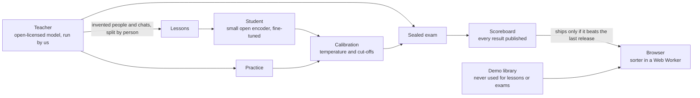

# Bundle (claude-bundle)
<!-- CI badge: added in W7 -->

Status: DRAFT — work in progress; the foundation is being laid (BDL-3). Where it stands: [STATUS.md](STATUS.md).

An open-source project by the Zugzwang Foundation. **Bundle is a working name.**

## What Bundle is

Bundle is a small open decision model that sorts a person's AI chats into bundles. Given a new chat and the person's bundles and loose chats, it returns a probability for each, plus one for "none of these", and never writes text. Three rules turn that into action: file when very sure, suggest when fairly sure, leave loose otherwise. It learns only from invented chats written by an open-licensed teacher model, and a sealed exam decides every release. The demo site lets anyone feel the problem and the fix in two minutes. The full spec is in [docs/SPEC.md](docs/SPEC.md).

## How it fits together



- The **teacher** is an open-licensed model we run ourselves. It writes invented people, their lives and their chats, each with the right bundle. No real chats, no copied web text.
- The **lessons**, **practice** tests and **sealed exam** are split by person and never mixed.
- The **student** is a small open encoder fine-tuned to answer "which bundle, or none" with probabilities. It is small enough to run in a web browser.
- **Calibration** on the practice split sets the temperature and the two cut-offs, so a stated 90% is right about nine times in ten.
- The **scoreboard** publishes every exam result next to a no-training baseline, the previous student and open comparators. A release ships only if it beats the last one.
- The **browser** runs the sorter in a Web Worker (WebGPU where available, WASM otherwise). The demo's chat library is written separately and is never training data.

The longer version, with the repository layout and the privacy boundary, is in [docs/ARCHITECTURE.md](docs/ARCHITECTURE.md).

### What the model answers

One question, version 0. Request:

```json
{"chat": "banana calories after my long run",
 "candidates": [
   {"id": "b1", "kind": "bundle", "label": "Running", "examples": ["beginner half marathon plan", "knee hurts after 10k"]},
   {"id": "c9", "kind": "loose", "text": "why do cats knead blankets"}]}
```

Response:

```json
{"probabilities": {"b1": 0.94, "c9": 0.01, "none": 0.05}, "action": "file", "target": "b1"}
```

The action is `file`, `suggest` or `leave`. Choosing a loose chat means "start a new bundle with it".

### Privacy

The visitor's quiz answers, taps and typed text never leave the browser. After the page loads, the only network requests are the model download and the site's own static files. No cookies, no analytics, no localStorage or sessionStorage. We store nothing about visitors and never train on anything they do.

## Running it

The `web/` and `pipeline/` folders land as their BDL-3 workstreams merge; until then the commands below describe the intended setup.

**Website** (`web/`): a static Vite + React + TypeScript site. Node is pinned to 24.21.0 in `.node-version`; use a version manager that reads it, never the system Node.

```sh
cd web
npm ci
npm run dev      # local site
npm test         # unit tests (Vitest)
npm run e2e      # the whole flow in Playwright, at 390×844 and 1440×900
```

**Pipeline** (`pipeline/`): a Python project managed by [uv](https://docs.astral.sh/uv/), package `bundle_pipeline`. The Python version is pinned in `pipeline/.python-version`; never use the system Python.

```sh
cd pipeline
uv sync --frozen
uv run bundle-pipeline --help
uv run pytest    # tests run on a two-person fixture, with no model downloads
```

## Where to read more

- [docs/SPEC.md](docs/SPEC.md) — the product specification.
- [docs/ARCHITECTURE.md](docs/ARCHITECTURE.md) — components, data flow, the decision API, the repository layout, the privacy boundary and the nightly loop.
- [docs/DECISIONS.md](docs/DECISIONS.md) — one dated line per decision, newest first.
- [docs/research/](docs/research/) — the research tracks and their frank recommendations.
- [STATUS.md](STATUS.md) — what is done, what is next and what is ready to show.

## Licences

Code is licensed under the Apache License 2.0 ([LICENSE](LICENSE)). Documentation, meaning the Markdown files and everything in `docs/`, and the datasets are licensed under Creative Commons Attribution 4.0 International ([LICENSE-docs](LICENSE-docs)). Model weights will be released under the Apache License 2.0 (D12), so every base model we train from must be under Apache-2.0 or MIT.

## Independence

An independent open-source project, not affiliated with any AI company. The Zugzwang Foundation is not affiliated with, sponsored by or endorsed by Anthropic. Claude is a trademark of Anthropic, PBC. Bundle is a working name.
