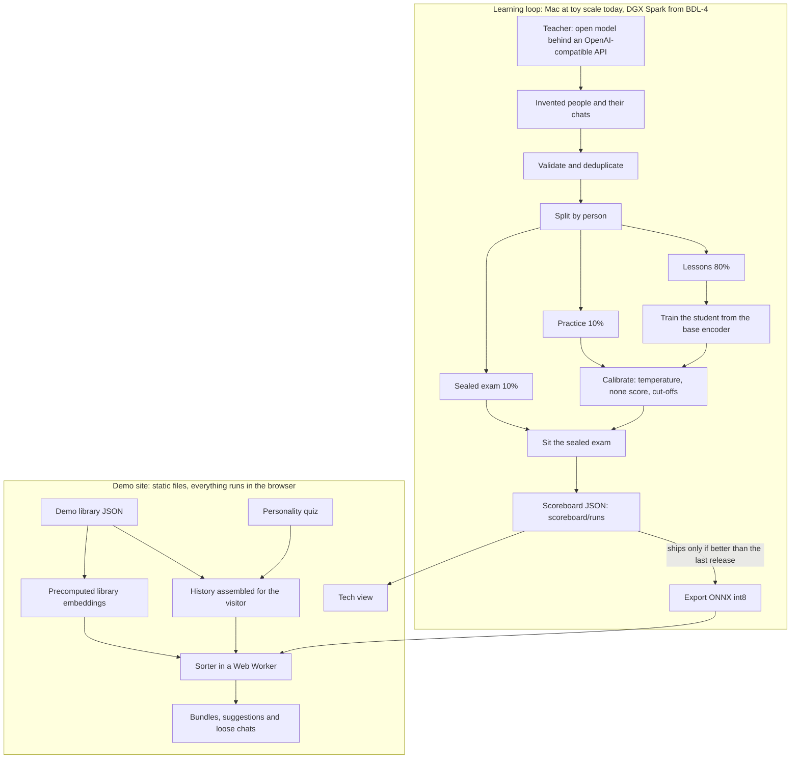

# Bundle: architecture

Status: DRAFT — how the parts fit together and what moves between them, written before the code runs, so paths and numbers may still change, 2026-10-16.

Bundle is a working name. The product is defined in [SPEC.md](SPEC.md); the decisions referred to below (D1 to D13) are in [DECISIONS.md](DECISIONS.md). Where this document names a model, a version or a size it has not yet checked, it says NOT VERIFIED.

## 1. Components and data flow



Walk-through. A teacher model that we run ourselves (D3, D9) writes invented people, their lives and their chats, each chat labelled with the bundle it belongs to or with "none". The pipeline validates the output, removes near-duplicates and splits the people into three sets that never mix (D7): lessons for training, practice for calibration, and a sealed exam that decides releases. The student, a small encoder fine-tuned from an open base (D5), trains on the lessons. Calibration on the practice set fixes the temperature, the constant score for "none" and the two cut-offs that turn probabilities into actions (D6). The student then sits the sealed exam; the result is written as one JSON file per run under `scoreboard/runs/` and published. Only a student that beats the previous release on the exam is exported to ONNX at int8 and shipped to the site (D7).

The demo site is static (D8). A short quiz picks three to five interests; a nine-month chat history is assembled for them from the demo library, which is written separately and never used as lessons or exam data (D4). The sorter runs in a Web Worker on the visitor's device, with WebGPU where available and WASM otherwise, and starts loading during the quiz. Library embeddings are computed at build time with the same model and the same code; the visitor's own chats are embedded live. When the visitor flips the one switch, the sorter scores every chat against every bundle and loose chat, the three rules apply, and the chats move. The tech view shows the live probabilities and the latest scoreboard run.

## 2. The decision API v0 and the three rules

The model answers one question: given a new chat and the person's existing bundles and loose chats, which one does it belong to, or none? It returns probabilities and never writes text.

Request:

```json
{"chat": "banana calories after my long run", "candidates": [{"id": "b1", "kind": "bundle", "label": "Running", "examples": ["beginner half marathon plan", "knee hurts after 10k"]}, {"id": "c9", "kind": "loose", "text": "why do cats knead blankets"}]}
```

Response:

```json
{"probabilities": {"b1": 0.94, "c9": 0.01, "none": 0.05}, "action": "file", "target": "b1"}
```

- A candidate of kind `bundle` has a label and a few example chats. A candidate of kind `loose` is a single chat that sits in no bundle yet.
- Choosing a loose chat means "start a new bundle with it": the new chat and the loose chat become a bundle of two.
- `none` means the chat belongs with nothing the person has, so it stays loose on its own.
- In v0 `target` is the id with the highest probability, `none` included, and `action` says what to do about it. (Reading taken in W1; W3 and W5 may fix the field differently.)

The three rules (D6):

| action | when |
|---|---|
| `file` | the top probability belongs to a candidate and is at least the file cut-off |
| `suggest` | the top probability belongs to a candidate and is at least the suggest cut-off |
| `leave` | otherwise, including every case where the top probability belongs to `none` |

Sorter v0 maths, the same in Python (`pipeline/`) and TypeScript (`web/src/sorter/`):

1. Embed each text with the base encoder: mean pooling over tokens, then L2 normalisation. The base today is sentence-transformers/all-MiniLM-L6-v2, served to the browser as Xenova/all-MiniLM-L6-v2 at int8 (dtype q8), about 23 MB. NOT VERIFIED until W5 and W6 check the model card, the licence and the file size.
2. A bundle's vector is the normalised mean of its examples' vectors. A loose chat's vector is its own.
3. Each candidate's score is the cosine similarity between the chat's vector and the candidate's vector. `none` gets a constant score set by calibration.
4. Probabilities are `softmax(scores / temperature)`.
5. The rules above turn the probabilities into an action.

The temperature, the `none` score and the two cut-offs come from calibration on the practice split, aiming at 95% precision for `file` and 80% for `suggest` (D6), and are published with each scoreboard run. The student later replaces the base encoder in step 1; the rest of the maths does not change. In the toy run the no-training baseline (B1) is this maths over the base encoder as it is.

Research track R1 ([research/decision-models.md](research/decision-models.md)) decides whether a Jev-compatible form of the same question is also offered alongside this one.

## 3. Repository layout

```
web/                      Vite + React + TypeScript static site (Node 24.21.0 via .node-version), Biome, Vitest, Playwright
  src/config.ts           APP_NAME = "Bundle" and the footer line, the only place the name lives
  src/styles/tokens.css   design tokens, light and dark
  src/content/library/    demo library JSON (one file per interest) + library.schema.json; demo content only (D4)
  src/content/assemble.ts builds a visitor's nine-month history from the library
  src/sorter/             worker.ts (Transformers.js in a Web Worker, WebGPU then WASM), scoring.ts, rules.ts, calibration.json, model-manifest.json
  src/screens/            Welcome, Quiz, History, Chat, MonthsPass, Challenge, Reveal, Continue
  src/tech/               tech view: probability bars, model info and latency, SVG architecture diagram, scoreboard, roadmap
  src/generated/          precomputed library embeddings (gitignored, built by web/scripts/precompute-embeddings.mjs)
  public/fonts/           self-hosted Bricolage Grotesque and Atkinson Hyperlegible (OFL)
  public/models/          student model files for the browser (gitignored; the manifest points here when a student ships)
  scripts/                precompute-embeddings.mjs, validate-library.mjs
  e2e/                    Playwright flow at 390x844 and 1440x900
pipeline/                 uv project, package bundle_pipeline: schema, teacher, prompts, generate, validate, split, tasks, baseline, train, calibrate, exam, export, scoreboard; tests/fixtures (two-person fixture)
scoreboard/runs/          one JSON per exam run, labelled "toy scale" today
scripts/spark/            commands and configs for the DGX Spark (written later, not run)
docs/                     SPEC.md, ARCHITECTURE.md, DECISIONS.md, research/, release/
.github/workflows/ci.yml  web job and pipeline job
```

Generated data, model weights and local runtimes are gitignored; the exceptions are test fixtures under 200 KB, the demo library and the scoreboard JSON.

## 4. The privacy boundary

The site has no backend and no account. After the page loads, the only network requests are the model download and the site's own static files, and neither carries anything the visitor picked or typed. The site uses no cookies, analytics, localStorage or sessionStorage (D2). W5's Playwright run of the whole flow is where to check this, by listing every request made; to be checked once the site exists.

| Never leaves the browser | Never stored anywhere |
|---|---|
| Quiz answers and the interests they pick | Anything about a visitor: no accounts, profiles or visit logs of ours |
| Every tap: chats opened, questions chosen, the switch flipped | Quiz answers and personality types |
| Anything typed into the chat box or the search box | Chats a visitor opened, typed or searched for |
| The assembled history and the chat the visitor is asked to find | Cookies, analytics events or identifiers |
| Embeddings, probabilities and the sorter's actions | Browser storage of any kind: no localStorage, sessionStorage or IndexedDB entries of ours |
| Timings: how long the search took before and after, and per-decision latency | Training data drawn from visitors: the model never learns from anything they do (D2) |

The model download itself is a plain file fetch from whichever host serves the model files; where the files should be served from, and whether to self-host them under `web/public/models/`, is for R4 ([research/browser-and-web.md](research/browser-and-web.md)).

## 5. The nightly loop on the Spark, later

From BDL-4 the DGX Spark runs the teacher and the real training (D10). Each night, in order:

1. Serve the teacher over an OpenAI-compatible API (vLLM or similar; R6 picks the stack). The pipeline's `teacher` client is the same one used on the Mac (D9).
2. Generate new lessons with fixed seeds: people, lives and chats covering the difficulty mix (overlaps, vague one-liners, chats that belong nowhere, follow-ups after long gaps, typos and lower case, very short chats, chats that open a new thread).
3. Validate: schema, deduplication, label sanity.
4. Split by person, deterministically: 80% lessons, 10% practice, 10% sealed exam. Record the exam's hash.
5. Train the student on the lessons.
6. Calibrate on the practice split: temperature, `none` score, then the cut-offs that give at least 95% precision for `file` and at least 80% for `suggest`.
7. Sit the sealed exam. Record accuracy and macro-F1, precision and recall for `none`, expected calibration error and Brier score, precision and coverage at the two cut-offs, latency and size, for every sorter on the board (D11).
8. Write `scoreboard/runs/<run-id>.json`.
9. Export the student to ONNX with int8 quantisation and check that Transformers.js and PyTorch give matching embeddings on the fixture texts (cosine at least 0.999), or record the gap.
10. Ship only if the exam beats the previous release (D7): copy the files to `web/public/models/` and point `model-manifest.json` at them. Otherwise the site keeps the previous model and the board says so.

The ship rule is D7: a release ships only if it beats the previous one on the sealed exam, and every result is published, including the ones that did not ship.

## 6. Open questions

Each points to a research track under [docs/research/](research/), written in W2.

- R1 [decision-models.md](research/decision-models.md): should the API also accept a Jev-compatible form of the question, and how do the open decision models (Clef, Clef-flash, Strands Decider 2B and others) compare as comparators or as bases?
- R2 [student-and-method.md](research/student-and-method.md): which base encoder, and which method for "which bundle, or none": bi-encoder with a calibrated head as in v0, a cross-encoder, set classification, or fine-tuning a decision model. How best to handle chats that belong nowhere, and which calibration method and metrics to standardise on.
- R3 [teacher-and-data.md](research/teacher-and-data.md): which teacher, which serving stack, how to keep the lessons varied, and how to keep the sealed exam honest. In particular, whether the exam is re-split every night (as step 4 above reads) or fixed across runs so that releases are compared on the same questions.
- R4 [browser-and-web.md](research/browser-and-web.md): Transformers.js and ONNX Runtime Web versions, WebGPU and WASM support on phones, worker and caching patterns, realistic download and latency budgets, and where to serve the model files from.
- R5 [prior-art.md](research/prior-art.md): how the chat apps organise chats today, what the auto-sorting extensions do, and where Bundle differs or does not.
- R6 [dgx-spark.md](research/dgx-spark.md): the Spark's specs and software, serving and fine-tuning tooling, SSH access from the Mac, and running the loop overnight.

Also open, and not yet assigned: the second question, "is this a follow-up to that chat?", which the relay lists as a toy experiment if time remains; and what `target` holds when the action is `leave` (section 2).
